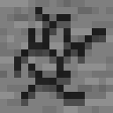
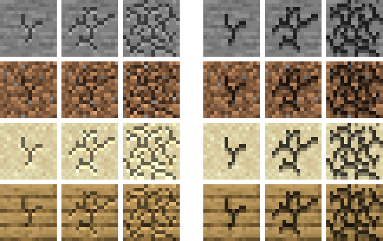

# Bedrock Breaking Animation

A resource pack for Minecraft Java Edition 26.3 that draws the cracks on a block you are breaking
the way Bedrock Edition does: dark, solid cracks that cut into the block, instead of Java's softer
cracks that also lighten parts of the block.

*[Po polsku niżej.](#po-polsku)*

<p></p>



*Left: vanilla Java. Right: with this pack, the same as Bedrock. Stages 2, 5 and 8 on stone, dirt,
sand and oak planks, worked out from the game's blending, pixel for pixel.*

## Install

1. Get the pack from [Modrinth](https://modrinth.com/resourcepack/bedrock-breaking-animation): in
   the Modrinth App search for **Bedrock Breaking Animation** and click **Install**, or download
   the `.zip` and put it, still zipped, in the profile's `resourcepacks` folder.
2. In the game: **Options → Resource Packs**, move **Bedrock Breaking Animation** to the
   right-hand list and click **Done**.

## Good to know

- **The crack pictures are the same in both editions.** Bedrock and Java ship identical
  `destroy_stage` textures (the Minecraft Wiki files are named "JE2 BE2", and they match the 26.3
  client byte for byte). What differs is the blending: Java multiplies the block by twice the
  crack's grey, so the light parts of a crack brighten the block, while Bedrock multiplies by the
  grey once, so every part of a crack darkens it. Mojang tracks this as
  [MCPE-46176](https://bugs.mojang.com/browse/MCPE/issues/MCPE-46176).
- **The pack halves the greys.** Java's doubling then lands on Bedrock's result: dark crack pixels
  keep 24% of the block's colour and light ones 61%, the same as Bedrock to within half a percent.
- **Improved Transparency is covered too.** With that option on, 26.3 draws a second set of
  cracks (`destroy_oit_stage`) with ordinary transparency; the pack replaces those with black
  cracks at the matching opacity, so both settings look the same.
- **The animation itself is unchanged.** Ten stages, the same crack shapes and timing; only the
  shading changes.
- **Other packs that change the cracks** win only if they sit above this one in the list.

## Building

```
python3 tools/make_textures.py path/to/26.3.jar
./publish.sh build
```

The first line makes the textures, the icon and the comparison picture from the vanilla client
jar. The zip ends up in `dist/`. `./publish.sh` without `build` also uploads it to Modrinth as the
version in `VERSION` (set `CHANGELOG="what changed"` first); the token is read from
`MODRINTH_TOKEN`, or else from `~/.config/modrinth/token`.

## License

The scripts, pack configuration and README images are MIT licensed, see [LICENSE](LICENSE). The
crack textures are made from Minecraft's own textures, which belong to Mojang.

Not an official Minecraft product. Not approved by or associated with Mojang or Microsoft.

---

## Po polsku

Paczka zasobów do Minecraft Java Edition 26.3, która rysuje pęknięcia na niszczonym bloku tak jak
Bedrock Edition: ciemne, wyraźne rysy wcięte w blok zamiast łagodniejszych pęknięć z Javy, które
przy okazji rozjaśniają część bloku.

Instalacja: pobierz paczkę z [Modrinth](https://modrinth.com/resourcepack/bedrock-breaking-animation)
(w Modrinth App wyszukaj **Bedrock Breaking Animation** i kliknij **Install** albo wrzuć pobrany
`.zip`, bez rozpakowywania, do folderu `resourcepacks`), a potem w grze **Opcje → Paczki zasobów**,
przenieś **Bedrock Breaking Animation** na prawą listę i kliknij **Gotowe**.

- **Obrazki pęknięć są w obu edycjach te same** — różni się mieszanie z blokiem: Java mnoży kolor
  bloku przez podwojoną szarość pęknięcia, więc jasne części rozjaśniają blok, a Bedrock mnoży raz,
  więc każda część pęknięcia go przyciemnia. Mojang ma to jako
  [MCPE-46176](https://bugs.mojang.com/browse/MCPE/issues/MCPE-46176).
- **Paczka zmniejsza szarości o połowę**, więc podwojenie w Javie daje wynik z Bedrocka: ciemne
  piksele zostawiają 24% koloru bloku, jasne 61%, z dokładnością do pół procenta.
- **Działa też z opcją Ulepszona przejrzystość** — 26.3 rysuje wtedy osobny zestaw pęknięć
  (`destroy_oit_stage`); paczka podmienia go na czarne pęknięcia o pasującej nieprzezroczystości.
- **Sama animacja się nie zmienia** — dziesięć etapów, te same kształty i tempo, inne jest tylko
  cieniowanie.
- **Inne paczki zmieniające pęknięcia** wygrywają tylko, gdy są wyżej na liście.

Skrypty, konfiguracja i obrazki w README na licencji MIT; tekstury pęknięć powstały z tekstur
Minecrafta, które należą do Mojang. To nie jest oficjalny produkt Minecraft; nie jest zatwierdzony
przez Mojang ani Microsoft ani z nimi powiązany.
